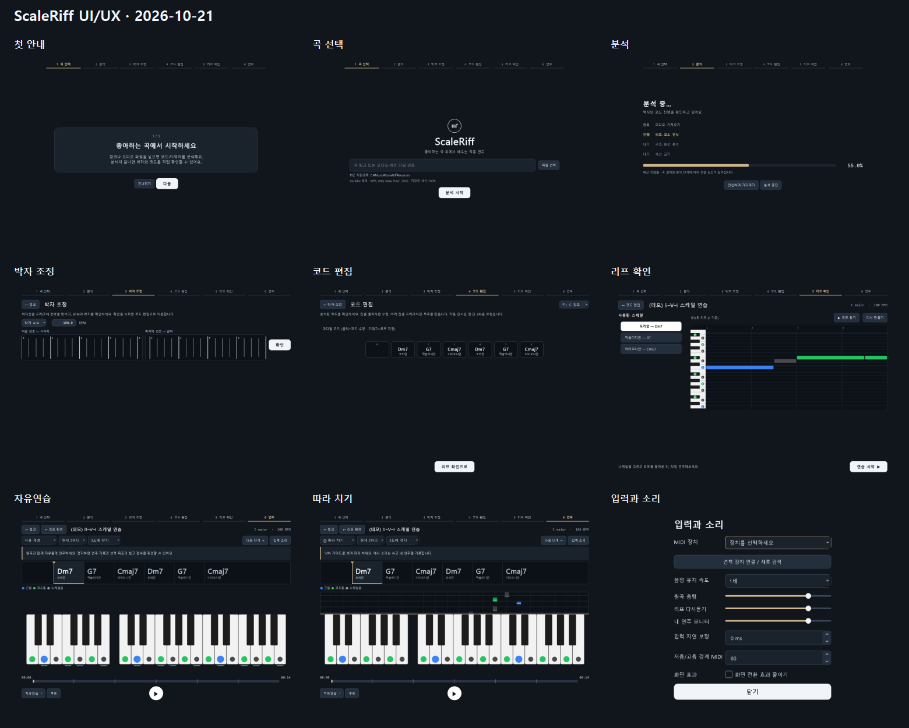

# ScaleRiff UI/UX 관리

기준일: 2026-10-21. 사용자가 선택한 방향은 **다크 스튜디오: 정보는 또렷하게, 연주 효과는 절제**다.
현행 UI 기준은 이 문서와 `gui/theme.py`다. 과거 `SCALERIFF_DESIGN_SPEC.md`의 고정 75% 영역·색상·폰트·입장 효과 규칙보다 우선한다.

## 목적과 보존 조건

- 곡 선택 → 분석 → 박자 조정 → 코드 편집 → 리프 확인 → 연주의 현재 위치와 다음 행동을 명확하게 한다.
- 준비 화면은 읽기 좋은 폭, 편집·연주는 창 전체 공간을 사용한다. 기준 창은 1040×740, 1280×800, 1600×1000이다.
- 최근 저장경로는 입력란 아래 읽기 전용 표시를 유지한다. 박자 확인 후 코드 편집으로 이동하는 흐름을 유지한다.
- 기존 수동 코드·루프·세션·MIDI·채점·듣기/모방/변주/자유/재청취 동작을 유지한다.
- 실제 소스의 피아노 색 배지, 눌림 색, **건반 하단 다음 음 막대**를 유지한다. 이전 기록의 상단 왕관은 현재 구현과 달라 적용하지 않는다.
- UI 작업 범위는 구성·표시·조작 피드백이다. 음악 분석·생성·점수 알고리즘은 변경하지 않는다.

## 벤치마크와 채택 판단

2026-10-21 공식 소개/도움말을 확인했다. 제품을 직접 실행한 비교나 학습 효과 검증은 아니다.

| 출처 | 확인한 요소 | ScaleRiff 적용 판단 |
|---|---|---|
| [Synthesia](https://synthesiagame.com/) | 낙하 노트, 다음 음 표시, 즉시 연주 피드백 | 기존 낙하 가이드를 유지하며 박 기준선·착지선·노트 끝의 명암을 더해 음 길이와 도착 지점을 구분한다. 정지하면 효과도 정지한다. |
| [Ableton Live 화면 안내](https://help.ableton.com/hc/en-us/articles/12243771208092-Navigation-and-View-Options-in-Live-12-FAQ) | 필요한 패널 펼치기, 키보드 탐색, 화면 대비 | 연주 공간을 우선 배분하고 입력·소리 설정과 루프는 필요할 때 연다. 포커스와 선택 상태를 구분한다. |

무조건적인 번쩍임·폭죽·화면 흔들림은 채택하지 않는다. 박자와 무관한 움직임은 연주 집중에 도움이 되지 않는다는 **디자인 판단**이며 효과를 실험으로 검증했다는 뜻은 아니다.

## 디자인 규칙

| 역할 | 기준 |
|---|---|
| 바탕 | graphite `#11161d` |
| 패널 / 안쪽 | `#1a222c` / `#0c1117` |
| 보조 표면 / 테두리 | `#242f3d` / `#394656` |
| 제목 / 본문 / 보조 | `#f1f5f9` / `#d6dfe8` / `#b2bfcc` |
| 현재 단계·포커스 | brass `#cfb68b`, 음악 안내색과 구분 |
| 음악 안내 | 근음 파랑·코드톤 초록·스케일 회색 유지; 색의 뜻을 텍스트로 병기 |
| 글꼴 | Windows 기본 Malgun Gothic / Segoe UI / Consolas. Qt 폰트 대체 지원. 없는 번들 폰트의 설치를 전제하지 않는다. |
| 크기 | 화면 제목 24px, 본문 13–14px, 보조 11–12px. 버튼 36px 이상, 주요 재생 52px. |
| 여백 | 화면 28×20px, 그룹 12–20px. 패널·컨트롤·음표의 모서리 곡률을 역할에 따라 구분한다. |
| 입력 상태 | 기본·hover·pressed·focus·disabled 표시, 조작 이름과 툴팁 제공 |
| 전환 | 한 화면에서 한 그룹만 180ms 페이드, 항목별 지연 기본 0. 연주 건반·타임라인의 데이터 갱신에는 페이드를 적용하지 않는다. |
| 효과 줄이기 | 입력·소리 설정에서 저장. 장식용 전환을 생략하며 음표의 시간·공간 안내는 유지한다. |

## 화면별 구성과 완료 기준

| 화면 | 변경 | 완료 기준 |
|---|---|---|
| 첫 안내 | 이모지 의존을 줄인 단계 설명, 현재 카드 위치 | 다음/시작 및 건너뛰기가 동작한다. |
| 곡 선택 | 넓이 자동 조절 입력, 지원 형식 안내, 최근 경로, 주 행동 | 입력이 잘리지 않고 Enter/파일 선택 경로가 유지된다. 빈 입력에는 안내와 포커스를 준다. |
| 분석 | 예상 진행률 명시, 세로 단계 목록, 상세 메시지 줄바꿈 | 100%는 실제 완료 시에만 표시. 실패·취소·백그라운드 동작 보존. |
| 박자 | 짧은 핵심 안내, 상세 설명은 툴팁, 두 파형을 넓게 | BPM/박자/시작박 변경과 확인 동작 유지, 추정 실패 안내 보존. |
| 코드 편집 | 표의 넓은 배치, 스크롤, 반복/선택/hover 구분 | 긴 곡도 세로 스크롤 가능, 코드·루프 수정 유지. |
| 리프 확인 | 왼쪽 스크롤 목록 + 오른쪽 큰 피아노롤 | 스케일 수가 많아도 시작 버튼을 밀어내지 않으며 재생성/미리듣기 유지. 빈 상태도 다음 행동 표시. |
| 연주 | 곡/과제/피드백/코드/가이드/건반/재생의 위계, 안내색 범례 | 피아노와 재생줄 노출, 낙하 노트의 실제 건반 정렬, 재생/정지/루프/채점 유지. |
| 입력·소리 / 루프 | 공통 컨트롤, 충분한 간격, 빈 상태 안내 | 장치 새로 검색, 속도/음량/보정/분할 설정과 효과 줄이기 유지. |

## 관리 방법

1. 새 문제는 먼저 `IMPROVEMENTS.md`에 UI ID·근거·완료 기준과 함께 추가한다.
2. 이 문서에서 해당 화면/규칙을 갱신하고 `UI_UX_PLAN.md`의 체크 상태를 바꾼다.
3. 기능 검사는 `.venv/Scripts/python.exe tests_ui_ux.py`, 전체 검사는 `tools/run_checks.py`로 실행한다.
4. 렌더는 `tools/capture_ui.py --output cache/ui_ux/after`로 생성하고 실제 이미지를 확인한다.
5. 결과는 아래 변경 기록에 날짜·검증 명령·사진·미검증 범위와 함께 남긴다. 계획만으로 완료 표시하지 않는다.

## 변경·검증 기록

- 2026-10-21: 모든 화면과 기존 사용자 수정 확인. 고정 75% 콘텐츠, 고정 620px 입력, 반복 opacity 효과 교체, 긴 안내문, 스크롤 없는 스케일 목록을 개선 대상으로 등록했다.
- 설계 검토 반영: 긴 이름의 루프 20개·피드백의 스크롤, 창 크기 변경 없는 레이아웃 이동 후 낙하 정렬도 완료 기준에 포함한다.
- 렌더 환경 확인: Windows offscreen의 폰트 목록이 비어 있어 시스템 기본 글꼴을 명시적으로 로드한다. Qt 기본 밝은 배경도 페이지 팔레트에 명시해 실제 다크 배경으로 렌더한다.
- 구현: 75% 공통 영역을 제거하고 준비 화면만 최대 860px로 제한했다. 전체 흐름 표시, 길이에 맞는 입력·제목 말줄임·스크롤 목록, 리프 목록/피아노롤 분리, 연주 범례/피드백 영역을 적용했다.
- 전환: 기존 잠금 효과를 건드리지 않는 180ms 페이드로 바꾸고 재진입 시 이전 전환을 정리한다. 효과 축소는 설정에서 저장되며 실행 중 전환도 즉시 정리한다. 연주 건반·코드·음표에는 진입 페이드를 적용하지 않는다.
- 연주 효과: 실제 `beat_grid()`를 사용하는 낙하 박선, 노트 명암/끝선, 착지선, 현재 코드 하단 표시를 적용했다. 시킹 바의 위치 미리보기와 방향키/Home/End 탐색도 추가했다.
- 기존 눌림색 보존: UI 테두리 토큰 변경이 회색 스케일 건반의 눌림색까지 바꾸지 않도록 기존 `#555555`를 별도 토큰으로 유지했다.
- 코드 검토: 이동한 시작박과 낙하 박선의 불일치, 스크롤 내부의 밝은 기본 배경, 숫자 입력 화살표 대비를 발견해 수정했다. 세 항목을 별도 실행 검토에서도 확인했다.
- 안내 일치: 따라 치기에서 자유연습 메뉴로 전환한 뒤 이전 안내가 남는 문제를 재현하고, 메뉴 선택 시 해당 모드의 안내로 바꾸도록 수정했다.
- 캡처 격리: 더미 저장 대상은 전체 실행 동안 임시 폴더다. 표시용 경로가 실제 저장 목적지를 바꾸던 문제를 RED→GREEN으로 검사했다. 실제 표시 경로의 파일/폴더가 생성되지 않았음을 확인했다.

### 검증 결과 — 2026-10-21

| 검사 | 근거 / 결과 |
|---|---|
| UI 회귀 + 기존 학습 흐름 | `python -m unittest tests_ui_ux tests_learning_flow` **21/21 통과**. 새 UI 검사 14건 포함. |
| 전체 unittest | `python -m unittest discover -p 'tests_*.py'` **84/84 통과**. 로그 `cache/ui_ux/unittest.txt`. |
| 기존 스모크 | 저장경로/실제 저장, 박자→코드→리프→연주, 수동 수정/루프/예고/채점 경로 통과. 과거 75% 영역·단계 기호 단언만 새 UI 계약에 맞췄다. |
| 전체 스크립트 | `python tools/run_checks.py` **23/23 통과**. 각 스크립트 실제 진입점 실행. 외부 다운로드 `tests_mir_real.py`는 제외. 로그 `cache/ui_ux/checks.txt`. |
| 정적 검사 | `python -m compileall -q gui tools/capture_ui.py tests_ui_ux.py tests_smoke.py tests_analysis_progress.py`, `git diff --check` 통과. |
| 렌더 | 960×700, 1040×740, 1280×800, 1600×1000 요청 창의 11개 상태, **44개 PNG**. 상태 표시줄을 제외한 실제 페이지 크기는 `cache/ui_ux/after/README.md`에 별도 기록. |
| 경계 입력 | 많은 스케일 30개, 긴 루프 이름 20개, 긴 피드백, 빈 리프, 빈 입력, 효과 중복/잠금/삭제, 모드 전환, 수동/가변 박과 루프 예고 검사. |

전후 자료: `cache/ui_ux/source_before`, `cache/ui_ux/before`, `cache/ui_ux/after`.
수정 전 렌더는 보존된 UI 소스를 로드해 재현했으며, 글자가 보이도록 offscreen 폰트 로드만 보완했다. 수정 전에도 존재하던 Qt 기본 밝은 배경을 포함한 실행 환경의 결과이므로 실제 모니터 화면의 전후 측정으로 해석하지 않는다.
대표 결과는 저장소의 `document/ui_ux/`에 보존한다. 전체 크기별 원본·로그·수정 전 소스는 재생성 가능한 로컬 `cache` 자료다.

재생성 명령(저장소 루트 PowerShell):

```powershell
$env:PYTHONUTF8='1'
$env:QT_QPA_PLATFORM='offscreen'
& ./.venv/Scripts/python.exe tools/capture_ui.py --output cache/ui_ux/after --sizes 960x700,1040x740,1280x800,1600x1000
& ./.venv/Scripts/python.exe tools/run_checks.py
& ./.venv/Scripts/python.exe -m unittest discover -p 'tests_*.py'
```

### 화면 기록



원본: [첫 안내](ui_ux/onboarding.png), [곡 선택](ui_ux/link.png), [분석](ui_ux/analyzing.png),
[박자 조정](ui_ux/beat.png), [코드 편집](ui_ux/chords.png), [리프 확인](ui_ux/riffs.png),
[자유연습](ui_ux/play.png), [따라 치기](ui_ux/copy.png), [입력·소리](ui_ux/settings.png).

새 렌더를 확인한 뒤 대표 PNG와 위 미리보기·검증 날짜도 함께 갱신한다.

최종 상태: UI-01~UI-06 구현·자동 회귀·렌더 검증 완료. 독립 코드 검토에서 발견한 3건도 수정 후 재확인했다. 아래 실사용 검증은 완료 범위에 포함하지 않는다.

## 검증 경계

자동 입력/렌더로 화면 배치와 기존 기능 회귀를 확인한다. 실제 모니터별 DPI·MIDI 지연·스피커 청감·장시간 플레이·사용자 선호/학습 효과는 별도 실사용 검증이 필요하다.

| 후속 ID | 확인할 조건 | 완료 기준 |
|---|---|---|
| UX-F01 | Windows 실제 모니터 100/125/150/200% 배율 | 최소/최대 창과 모니터 이동 시 글자·건반·설정이 잘리지 않음 |
| UX-F02 | 실제 피아노·사용자 연주 | 한 곡 연주 중 정보 밀도·시선 이동·예고/타격감의 선호 확인, MIDI 지연/청감 검증과 구분 기록 |
